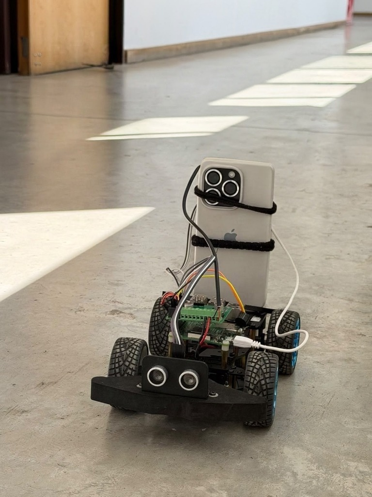

# Ojos para RaspiRobot

El proyecto usa un celular como cámara del robot. `vision.py` detecta colores,
movimiento o códigos QR y envía los resultados por MQTT a Node-RED. El flujo
también ofrece control manual, lectura del sensor ultrasónico, luces, buzzer y
seguimiento visual experimental.



## Qué necesitás

- Raspberry Pi 3 con Raspberry Pi OS.
- Celular con una app que publique video por HTTP, y una URL de stream accesible
  (por ejemplo, `http://IP_DEL_CELULAR:8080/video`).
- Node-RED y Mosquitto accesibles desde la Pi.
- En Node-RED: `@flowfuse/node-red-dashboard` y `node-red-node-pi-gpiod`.
- Para el sensor ultrasónico: `python3-rpi.gpio`.

La Pi, el celular y el equipo que abre el dashboard deben poder comunicarse en
la red. No guardes en el repositorio las direcciones IP de tu red ni
credenciales.

## Instalar en la Raspberry Pi

Instalá las dependencias del sistema y prepará el entorno virtual:

```bash
sudo apt update
sudo apt install python3-opencv python3-paho-mqtt python3-numpy \
  python3-venv python3-rpi.gpio mosquitto mosquitto-clients
cd ~/robot-cloud
python3 -m venv --system-site-packages .venv
source .venv/bin/activate
```

En Raspberry Pi OS, instalar OpenCV con `apt` y usar
`--system-site-packages` permite que el entorno vea `cv2`. No uses `sudo pip`
ni `--break-system-packages`. En otros sistemas, podés instalar las
dependencias del proyecto con `python -m pip install -r requirements.txt`.

Si la Pi no tiene acceso a GitHub, copiá el proyecto como ZIP desde otra
computadora:

```bash
git archive --format=zip -o ../robot-cloud.zip HEAD
scp ../robot-cloud.zip USUARIO@IP_DE_LA_PI:~
```

Luego, en la Pi:

```bash
mkdir -p ~/robot-cloud
unzip -o ~/robot-cloud.zip -d ~/robot-cloud
```

## Ejecutar la detección

1. Iniciá la app de cámara del celular y anotá su URL de video.
2. Comprobá que Mosquitto esté activo:

   ```bash
   sudo systemctl enable --now mosquitto
   ```

3. Desde `~/robot-cloud`, activá el entorno y ejecutá:

   ```bash
   source .venv/bin/activate
   python vision.py --url http://IP_DEL_CELULAR:8080/video \
     --modo color --color todos --broker localhost
   ```

`--color todos` detecta verde, rojo y amarillo. También están disponibles los
modos `movimiento` y `qr`; para seleccionar un solo color, usá `verde`, `rojo`,
`amarillo` o `azul`. El tópico MQTT predeterminado es `robot/vision` y el
puerto, `1883`. Para evitar escribir la URL cada vez, también se puede definir
`VISION_URL`; `MQTT_BROKER`, `MQTT_PORT` y `MQTT_TOPIC` permiten configurar el
broker y el tópico.

Para comprobar la cámara sin enviar mensajes MQTT, agregá `--sin-mqtt`. Para
abrir una ventana local de diagnóstico, agregá `--ver`. La cámara en el
dashboard se conecta directamente desde el navegador al celular; MQTT lleva
los resultados de detección, no el video.

## Importar y probar el flujo

1. En Node-RED, hacé una copia de seguridad e importá
   [`flows/flow_vision.json`](flows/flow_vision.json). Si ya importaste una
   versión anterior, quitá solo las pestañas de este proyecto para evitar
   duplicarlas.
2. Configurá el broker MQTT para que coincida con el de `vision.py`. Si ambos
   corren directamente en la Pi, usá `localhost` o `127.0.0.1`. En Docker,
   `localhost` apunta al contenedor, no a la Pi.
3. Hacé Deploy y abrí `http://IP_DE_LA_PI:1880/robot`.
4. En “Cámara en vivo”, ingresá la URL del celular y conectá. La URL se guarda
   en el navegador; el navegador también debe poder acceder al stream.
5. Ejecutá `vision.py` sin `--sin-mqtt`. Presentá un color y comprobá la
   detección en el dashboard.

Si no aparecen mensajes, podés observar el tópico desde otra terminal:

```bash
mosquitto_sub -h 127.0.0.1 -t robot/vision -v
```

Para probar MQTT manualmente, publicá un mensaje de ejemplo:

```bash
mosquitto_pub -h 127.0.0.1 -t robot/vision \
  -m '{"detectado":true,"x":0.5,"area":0.01,"modo":"prueba"}'
```

## Seguridad y pruebas con el robot

El control manual y el sensor ultrasónico funcionan desde el flujo. El
seguimiento visual es experimental, está apagado por defecto y no mide la
distancia al objeto. El sensor ultrasónico y el botón STOP tienen prioridad
para frenar; aun así, verificá el cableado y el sentido de los motores antes
de mover el robot.

Probá primero con las ruedas levantadas, en un área despejada y con una persona
junto al botón STOP. Activá el seguimiento solo después de comprobar motores,
servo y sensor. Los pines BCM, tópicos MQTT y detalles de seguridad eléctrica
están en [`docs/pines.md`](docs/pines.md).

## Problemas comunes

- **`No module named cv2` o `paho`:** activá `.venv` y verificá que se haya
  creado con `--system-site-packages`; en la Pi, instalá los paquetes indicados
  con `apt`.
- **`externally-managed-environment`:** no instales con `sudo pip`; usá los
  paquetes del sistema y el entorno virtual de arriba.
- **Mosquitto no conecta:** comprobá `sudo systemctl status mosquitto` y que
  Python y Node-RED usen el mismo broker, puerto y tópico.
- **No hay video:** probá la URL directamente desde el navegador del dashboard
  y confirmá que el celular siga transmitiendo en la misma red.
- **Nodos desconocidos en Node-RED o error del SR04:** instalá los módulos de
  Node-RED indicados arriba y confirmá `python3-rpi.gpio` y los permisos GPIO.

## Pruebas de software

Las pruebas de seguimiento y colores se pueden ejecutar sin conectar el robot:

```bash
node --test tests/vision-follow.test.cjs
python -m unittest discover -s tests -p 'test_vision_colors.py'
```
